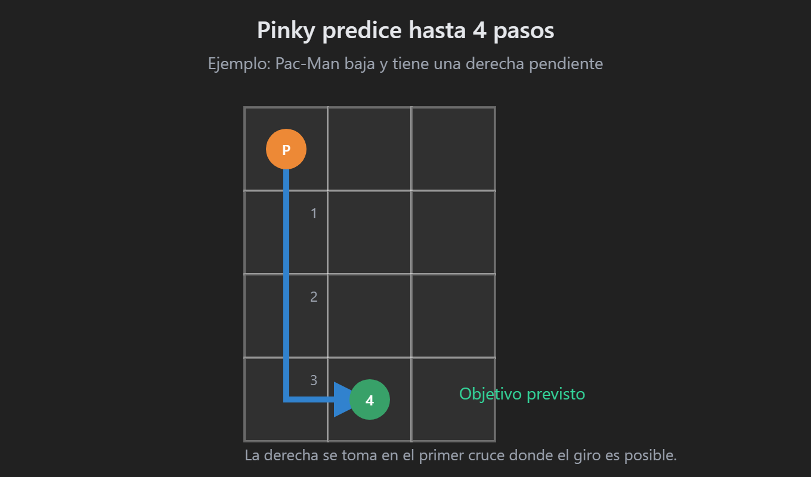

<div align="center">

[](https://ascii.rest/banner/)

</div>


```
.
├── Makefile
├── README.md
├── assets
│   ├── Attract Mode & HUD Assets.png
│   ├── Pinky.png
│   ├── animations
│   │   ├── frames.json
│   │   ├── ghosts
│   │   │   ├── blinky
│   │   │   │   ├── blinky_down
│   │   │   │   │   ├── frame_00.png
│   │   │   │   │   └── frame_01.png
│   │   │   │   ├── blinky_left
│   │   │   │   │   ├── frame_00.png
│   │   │   │   │   └── frame_01.png
│   │   │   │   ├── blinky_right
│   │   │   │   │   ├── frame_00.png
│   │   │   │   │   └── frame_01.png
│   │   │   │   └── blinky_up
│   │   │   │       ├── frame_00.png
│   │   │   │       └── frame_01.png
│   │   │   ├── clyde
│   │   │   │   ├── clyde_down
│   │   │   │   │   ├── frame_00.png
│   │   │   │   │   └── frame_01.png
│   │   │   │   ├── clyde_left
│   │   │   │   │   ├── frame_00.png
│   │   │   │   │   └── frame_01.png
│   │   │   │   ├── clyde_right
│   │   │   │   │   ├── frame_00.png
│   │   │   │   │   └── frame_01.png
│   │   │   │   └── clyde_up
│   │   │   │       ├── frame_00.png
│   │   │   │       └── frame_01.png
│   │   │   ├── inky
│   │   │   │   ├── inky_down
│   │   │   │   │   ├── frame_00.png
│   │   │   │   │   └── frame_01.png
│   │   │   │   ├── inky_left
│   │   │   │   │   ├── frame_00.png
│   │   │   │   │   └── frame_01.png
│   │   │   │   ├── inky_right
│   │   │   │   │   ├── frame_00.png
│   │   │   │   │   └── frame_01.png
│   │   │   │   └── inky_up
│   │   │   │       ├── frame_00.png
│   │   │   │       └── frame_01.png
│   │   │   ├── pinky
│   │   │   │   ├── pinky_down
│   │   │   │   │   ├── frame_00.png
│   │   │   │   │   └── frame_01.png
│   │   │   │   ├── pinky_left
│   │   │   │   │   ├── frame_00.png
│   │   │   │   │   └── frame_01.png
│   │   │   │   ├── pinky_right
│   │   │   │   │   ├── frame_00.png
│   │   │   │   │   └── frame_01.png
│   │   │   │   └── pinky_up
│   │   │   │       ├── frame_00.png
│   │   │   │       └── frame_01.png
│   │   │   └── scared_ghost
│   │   │       ├── frame_00.png
│   │   │       ├── frame_01.png
│   │   │       ├── frame_02.png
│   │   │       └── frame_03.png
│   │   └── player
│   │       ├── pac-man_death
│   │       │   ├── frame_00.png
│   │       │   ├── frame_01.png
│   │       │   ├── frame_02.png
│   │       │   ├── frame_03.png
│   │       │   ├── frame_04.png
│   │       │   ├── frame_05.png
│   │       │   ├── frame_06.png
│   │       │   ├── frame_07.png
│   │       │   ├── frame_08.png
│   │       │   ├── frame_09.png
│   │       │   ├── frame_10.png
│   │       │   ├── frame_11.png
│   │       │   ├── frame_12.png
│   │       │   ├── frame_13.png
│   │       │   ├── frame_14.png
│   │       │   └── frame_15.png
│   │       ├── pac-man_down
│   │       │   ├── frame_00.png
│   │       │   ├── frame_01.png
│   │       │   ├── frame_02.png
│   │       │   └── frame_03.png
│   │       ├── pac-man_left
│   │       │   ├── frame_00.png
│   │       │   ├── frame_01.png
│   │       │   ├── frame_02.png
│   │       │   └── frame_03.png
│   │       ├── pac-man_right
│   │       │   ├── frame_00.png
│   │       │   ├── frame_01.png
│   │       │   ├── frame_02.png
│   │       │   └── frame_03.png
│   │       └── pac-man_up
│   │           ├── frame_00.png
│   │           ├── frame_01.png
│   │           ├── frame_02.png
│   │           └── frame_03.png
│   ├── font
│   │   └── font_emulogic.ttf
│   ├── fonts
│   ├── logo
│   │   └── pacman_logo.png
│   ├── seleccion fantasma y pops de pollo , su posicion de inicio.png
│   └── visualization.png
├── config.json
├── en.subject.pdf
├── highscore
│   └── highscore.csv
├── pac-man.py
├── pyproject.toml
├── scripts
├── src
│   ├── __init__.py
│   ├── __main__.py
│   ├── core
│   │   ├── app.py
│   │   ├── engine.py
│   │   ├── entity.py
│   │   ├── ghost.py
│   │   ├── pacgum.py
│   │   └── player.py
│   ├── main.py
│   ├── maze
│   │   └── bitmap.py
│   ├── score
│   │   ├── highscore.py
│   │   └── score.py
│   ├── utils
│   │   ├── class_config.py
│   │   ├── class_maze.py
│   │   ├── error.py
│   │   └── utils.py
│   └── ux_ui
│       ├── instructions.py
│       └── menu.py
├── tests
│   └── test_highscore.py
├── uv.lock
└── wheels
    ├── mazegenerator-2.1.0-py3-none-any - copia
    │   ├── mazegenerator
    │   │   └── mazegenerator.py
    │   └── mazegenerator-2.1.0.dist-info
    └── mazegenerator-2.1.0-py3-none-any.whl

47 directories, 104 files
```
tree -I '.venv|.git'

## Configuración

El juego lee sus opciones desde un archivo JSON llamado `config.json`. El archivo admite comentarios: `#`, `//` y `/* ... */`.

La estructura exacta del archivo es una decisión del proyecto. Las claves del subject son sugerencias, pero el README debe explicar qué claves acepta el juego y cuáles son sus valores por defecto.
Try:
|
highscore_filename
highscore.csv
Nombre del archivo donde se guardarán las puntuaciones. Debe terminar en .csv.
level
10 niveles de 15 × 15
Lista de niveles. Cada nivel tiene su propio width y height.
width
15
Ancho usado para crear los niveles cuando no se proporciona una lista level.
height
15
Alto usado para crear los niveles cuando no se proporciona una lista level.
lives
3
Vidas iniciales; se limita al intervalo de 1 a 9.
pacgum
42
Cantidad de pacgums.
points_per_pacgum
10
Puntos obtenidos por cada pacgum normal.
points_per_super_pacgum
50
Puntos obtenidos por cada super-pacgum.
points_per_ghost
200
Puntos obtenidos por cada fantasma comestible.
seed
42
Semilla prevista para la generación de laberintos.
level_max_time
90
Tiempo máximo de cada nivel, en segundos.
Niveles
level es una lista de niveles, no un número. Cada elemento de la lista define el ancho y el alto de un nivel:

json
Copy
{
    "level": [
        {"width": 15, "height": 15},
        {"width": 17, "height": 17}
    ]
}
Try:
|
El juego requiere un mínimo de 10 niveles. Si se proporciona una lista con menos de 10, se completa hasta llegar a 10, usando niveles de 15 × 15 para los que faltan.

Si se proporciona level, los valores de width y height de la raíz no se usan. Si no se proporciona una lista level, se crean 10 niveles usando el width y el height de la raíz; si tampoco se indican, se usa el tamaño predeterminado de 15 × 15.

Valores inválidos y claves desconocidas
La configuración tiene valores por defecto para las claves que falten. Cuando se recibe un valor numérico fuera del intervalo establecido, se limita al valor más cercano permitido; por ejemplo, un lives de 45 se ajusta a 9. Si un valor no se puede convertir al tipo esperado, se usa el valor por defecto correspondiente y se muestra un mensaje de error claro.

Las claves desconocidas se ignoran. Los errores de configuración deben gestionarse sin mostrar un traceback.

Un archivo con sintaxis JSON rota —por ejemplo, un número escrito sin comillas y con letras— no es lo mismo que una clave con un valor inválido: no se puede construir la configuración porque el JSON no llega a cargarse. En ese caso se muestra un mensaje de error; actualmente no se debe afirmar que el juego continúa con los valores por defecto.

Generación de laberintos
El subject exige usar el paquete externo A-Maze-ing asignado al proyecto:

No se debe escribir un generador propio ni modificar el paquete.
El adaptador del proyecto debe ajustarse a la interfaz del paquete.
El parámetro PERFECT debe configurarse como False.
Si el generador falla, el error debe gestionarse limpiamente.
La integración del generador y el uso efectivo de la semilla deben documentarse cuando estén implementados y comprobados. No se afirma aquí que ya estén terminados.


15/10/2026
# Generación del laberinto y colocación de entidades

> Anotaciones del proyecto — 15/10/2026

## Cómo se conectan `main`, `App` y `Maze`

La idea es que cada parte tenga una responsabilidad clara:

| Clase o función | Qué hace en esta parte del proyecto |
|---|---|
| `main()` | Carga la configuración, crea `App` y devuelve el resultado de `app.run()`. No genera ni manipula mapas. |
| `App` | Recorre los niveles definidos en la configuración y organiza la preparación de cada uno. También guarda las posiciones iniciales de las entidades. |
| `Maze` | Hace de adaptador del paquete `mazegenerator`: genera el mapa y ofrece operaciones para calcular posiciones y comprobar qué celdas son alcanzables. |

`Maze` es la única clase del proyecto que importa `mazegenerator`. `App` decide cuándo toca preparar el mapa y le pasa a `Maze` el número, el ancho y el alto del nivel.

El flujo, simplificado, es este:

```python
app = App(config)
app.run()

# App prepara los niveles en orden
for number, level in enumerate(self.config.level, start=1):
    self._start_level(number, level)

# Maze elige la semilla y crea el generador
seed = self._seed if number == 1 else 0
generator = MazeGenerator(
    size=(width, height),
    perfect=False,
    seed=seed,
)
```

Este ejemplo muestra la idea general; no es una copia literal de cada línea del proyecto.

## Generación de niveles y semilla

`App._start_level()` llama a `Maze.generate_level()` con el número y las dimensiones del nivel. `Maze` crea un `MazeGenerator` nuevo y guarda la cuadrícula generada en `self._grid`.

Para el primer nivel se utiliza la semilla recibida desde la configuración. Para los siguientes se pasa `0`, que el paquete utiliza para generar un mapa aleatorio. Así, el código solicita que el primer nivel use una semilla fija y que los demás se generen aleatoriamente. Eso no significa que todos los mapas posteriores tengan que ser distintos entre sí: podría haber coincidencias.

El parámetro `perfect=False` se pasa al generador. El resto de la lógica de este proyecto trabaja sobre el mapa que devuelve el paquete; aquí no se construye un generador propio.

## Dónde empieza Pac-Man

Después de generar el mapa, `App._start_level()` llama a `center_comecocos()` para elegir la posición inicial de Pac-Man.

El método busca la celda distinta de `15` que esté más cerca del centro de la cuadrícula. El valor `15` representa una celda cerrada en las cuatro direcciones y se evita para que Pac-Man no empiece dentro de uno de esos bloques.

La cuadrícula se consulta como `grid[y][x]`: primero la fila (`y`) y luego la columna (`x`). Las posiciones que guardamos, en cambio, se expresan como `(x, y)`. Es importante no intercambiar esos dos órdenes.

## Zonas de las esquinas

Para colocar fantasmas y super-pacgums, `corner_zone_cells()` divide las esquinas del mapa en cuatro zonas. El orden siempre es:

1. Arriba a la izquierda.
2. Arriba a la derecha.
3. Abajo a la izquierda.
4. Abajo a la derecha.

El ancho de cada zona se calcula como una quinta parte del ancho del mapa, y su alto como una quinta parte de la altura. Se descartan las fracciones y se asegura un mínimo de una celda en cada dimensión.

| Tamaño del mapa | Tamaño de cada zona | Celdas por zona |
|---|---:|---:|
| 10 × 10 | 2 × 2 | 4 |
| 15 × 15 | 3 × 3 | 9 |
| 21 × 15 | 4 × 3 | 12 |
| 25 × 21 | 5 × 4 | 20 |

Las zonas se hacen mayores a medida que crece el mapa, para que haya más casillas posibles donde elegir las posiciones.

## Cómo se comprueba si una celda es alcanzable: BFS

`reachable_cells(start)` calcula qué celdas se pueden alcanzar desde una posición inicial. Para ello usa una búsqueda en anchura, conocida como BFS (*Breadth-First Search*).

La búsqueda empieza en `start` y va visitando las celdas vecinas a las que se puede llegar. Utiliza:

- Una `deque` como cola FIFO: las celdas descubiertas se añaden al final y se procesa primero la que lleva más tiempo esperando.
- Un conjunto `visited`: guarda las celdas ya descubiertas, para no procesarlas varias veces.
- Las paredes codificadas como bits: norte `1`, este `2`, sur `4` y oeste `8`.

Para moverse a una celda vecina, el método comprueba las dos caras que comparten las celdas: que no haya pared en la dirección de salida de la celda actual ni en la dirección opuesta de la celda vecina. Por ejemplo, para moverse al este, comprueba la pared este de la celda actual y la pared oeste de la siguiente.

Una celda con valor `15` tiene activados los cuatro bits de pared. Por eso no se puede entrar en ella desde una celda vecina siguiendo las reglas del BFS.

El método devuelve un conjunto de coordenadas `(x, y)` alcanzables. No guarda distancias ni números de oleada. Los números que aparecen en el dibujo explicativo muestran el orden aproximado en que se van descubriendo las celdas; no son un resultado que el método almacene.

## Elección de posiciones para fantasmas, super-pacgums y pacgums

App._start_level() calcula una vez las celdas alcanzables desde la posición inicial de Pac-Man y reutiliza ese resultado en las selecciones del nivel.

select_ghost_spawns(reachable) elige una celda alcanzable de cada zona de esquina para colocar los cuatro fantasmas.

select_super_pacgum_spawns(reachable, ghost_spawns) elige una celda alcanzable de cada zona de esquina para las cuatro super-pacgums. Descarta las posiciones ocupadas por los fantasmas.

select_pacgum_spawns(reachable, pacman_start, ghost_spawns, super_pacgum_spawns, requested) elige las posiciones de las pacgums normales. Solo selecciona celdas alcanzables y libres; excluye la posición de Pac-Man, las de los fantasmas y las de las super-pacgums. Las posiciones se eligen al azar y no se repiten.

## Qué pasa si no caben todas las pacgums
La cantidad solicitada se configura con pacgum. Su mínimo es 0 y no tiene un máximo fijo en la configuración, porque la cantidad que cabe depende del mapa generado.

Para calcular las posiciones posibles, el método parte de las celdas alcanzables y quita las que ya están ocupadas. Así no se basa únicamente en width × height: también tiene en cuenta las celdas no alcanzables y las posiciones de las demás entidades.

Si se solicitan más pacgums de las que caben, el programa coloca todas las que puede y escribe un mensaje de error en inglés en stderr. No se detiene ni reduce la cantidad sin avisar. El aviso lo emite Maze.select_pacgum_spawns(), que también realiza la selección.

## El BFS se calcula una vez por nivel
App._start_level() llama una vez a reachable_cells(self.pacman_start) y guarda el resultado en reachable. Después pasa ese conjunto a los métodos que necesitan comprobar qué celdas son alcanzables.

Así se evita repetir el recorrido BFS al seleccionar fantasmas, super-pacgums y pacgums normales.


## Puntuaciones (Highscore)

La gestión de puntuaciones vive en `src/score/highscore.py`, en la clase `HighScore`. Todos sus métodos son métodos de clase: no se crea ningún objeto, se llama a las funciones directamente (`HighScore.load()`, `HighScore.save()`...).

El ranking se guarda en el atributo de clase `HighScore.scores`: una lista de registros, donde cada registro es un diccionario con `name` y `score`. Esa lista en memoria es el ranking de verdad; el archivo es su copia de respaldo.

### El archivo de puntuaciones

- Vive en la carpeta `highscore/`, en la raíz del proyecto. El nombre de la carpeta es fijo en el código y se crea solo la primera vez que se guarda.
- El nombre del archivo vendrá de `config.json` (clave `highscore_filename`, que debe acabar en `.csv`). Config ya lee y valida esa clave; cuando conectemos esta clase con el juego, App se la asignará a `HighScore.filename` al arrancar.
- El formato interno es CSV: una fila por jugador, con `nombre,puntuación`, ordenado de mayor a menor y con solo el Top 10.

El CSV "de verdad", después de descodificar, se ve así:

```text
Luna,100
Marta,70
Aitor,40
```

Pero ese contenido nunca se guarda en claro: antes pasa por la ofuscación. Si abres el archivo con un editor verás una línea de letras y números sin sentido:

```text
Kw8LTVhUWmsoBAtNW1RaazoACQwLD0ZQWlFg
```

### Cómo se codifica y se descodifica

Para guardar, el texto del CSV pasa por tres pasos:

1. Se convierte a bytes (UTF-8).
2. Se aplica XOR con una contraseña fija, guardada como constante dentro de la propia clase. La contraseña se repite como clave hasta cubrir todo el texto: cada byte se mezcla con el byte de la clave que le toca.
3. El resultado son bytes que no se pueden escribir bien en un archivo de texto, así que se convierten a base64, que sí es texto normal. Eso es lo que se escribe.

Para leer, se hace lo mismo al revés: base64 a bytes, XOR otra vez, y de ahí sale el texto del CSV.

El truco es que XOR es su propio inverso: aplicarlo dos veces devuelve el original. Por eso un único método (`_xor`) sirve para codificar y descodificar, con `_encode` y `_decode` como envoltorios.

Si el archivo no es base64 válido, o al deshacer no se recupera texto UTF-8, `_decode` devuelve `None`: el archivo está dañado. Esto no es un cifrado fuerte, ni pretende serlo: es una protección ligera para que nadie edite el ranking a mano con el bloc de notas.

### Las 3 funciones

| Función | Recibe | Devuelve | Qué hace |
|---|---|---|---|
| `HighScore.load()` | Nada | La lista de registros (y la deja en `HighScore.scores`) | Lee el archivo, lo descodifica y rellena el ranking |
| `HighScore.save()` | Nada | `True` si el archivo quedó escrito; `False` si falló todo | Vuelca `HighScore.scores` al archivo |
| `HighScore.register(name, score)` | Un nombre y una puntuación | `True` si la puntuación entró en el Top 10; `False` si no | Limpia, valida, ordena, recorta a 10 y guarda |

#### `HighScore.load()`

- Si el archivo no existe, el ranking empieza vacío y sin ningún aviso: es lo normal la primera vez que se juega.
- Si el archivo está dañado, se escribe un aviso en inglés por stderr y el ranking empieza vacío, sin traceback. El archivo se regenerará en el próximo guardado.
- No revalida lo que lee: confía en el archivo porque el único escritor es `save()`, que guarda datos ya limpios y validados.

#### `HighScore.save()`

- Vuelca a disco lo que hay en memoria en ese momento.
- Si el disco falla (permisos, disco lleno...), lo intenta hasta 3 veces, con una cuenta atrás de 3, 2, 1 segundos entre intento e intento, avisando en inglés por stderr.
- Si agota los intentos, avisa del fallo total y devuelve `False`, sin traceback: el ranking sobrevive en memoria y el próximo guardado volverá a intentarlo.

#### `HighScore.register(name, score)`

Es el orquestador: hace todo, en este orden.

1. Limpia el nombre con las reglas de abajo. Si tras limpiar queda vacío, avisa y devuelve `False`.
2. Valida la puntuación con las reglas de abajo. Si no es válida, avisa y devuelve `False`.
3. Si el Top 10 está lleno, solo entra una puntuación estrictamente mayor que la última. Un empate no desplaza a quien llegó antes, y una puntuación menor se descarta sin tocar nada.
4. Añade el registro, ordena el ranking de mayor a menor y lo recorta a 10.
5. Llama a `save()` y devuelve `True` si el registro quedó dentro del Top 10 en memoria.

Dos detalles del ordenado: es estable, así que si dos registros empatan se conserva el orden de llegada y el nuevo se queda por detrás del anterior. Y los nombres pueden repetirse: no se quitan duplicados, porque pueden ser jugadores distintos con las mismas iniciales.

### Reglas del nombre y de la puntuación

**El nombre:**

- Máximo 10 caracteres; si tiene más, se recorta con un aviso.
- Caracteres permitidos: letras, dígitos y espacio. Cualquier otro carácter se elimina.
- Los espacios del final se quitan; los del principio se conservan, así se acordó.
- Si tras limpiar no queda nada, el registro se rechaza.

**La puntuación:**

- Un número entero mayor o igual que 0.
- `True` y `False` no valen: Python los trata como enteros y se descartan a mano.

### Nada de tracebacks

El subject lo prohíbe, y aquí se cumple: cualquier situación rara (archivo que no existe, archivo dañado, disco que falla) termina en un aviso en inglés por stderr y el juego sigue funcionando. Un fallo de disco jamás destruye el ranking en memoria.

### Conexión con el juego (pendiente)

La clase ya está terminada y probada, pero App todavía no la usa. La conexión, cuando llegue con la mecánica del juego, tiene tres puntos:

1. **Al arrancar:** `HighScore.filename = config.highscore_filename` (la clave ya existe en `config.json` y Config la valida).
2. **Una vez al inicio:** `HighScore.load()` para tener el ranking en memoria.
3. **Al terminar la partida** (momento 4, `_end_game`, que ya reserva ese paso): `HighScore.register(nombre, score)`.

Mientras tanto, la clase se puede usar de forma aislada:

```python
from src.score.highscore import HighScore

HighScore.register("Aitor", 846)   # limpia, valida, ordena y guarda
ranking = HighScore.load()          # lee el archivo y lo descodifica
```

Movimiento del jugador
El movimiento de Pac-Man se coordina desde App. _handle_events() recoge las teclas pulsadas y traduce las flechas de Pygame a las direcciones del juego (UP, RIGHT, DOWN y LEFT). En lugar de mover al jugador directamente al recibir cada evento, guarda las direcciones en list_key, un búfer de hasta dos posiciones:

La posición 0 conserva la dirección actual.
La posición 1 guarda el siguiente giro solicitado.
Si el búfer ya está lleno, una nueva tecla sustituye la dirección pendiente.
Así, Pac-Man puede continuar avanzando aunque el jugador no mantenga pulsada la tecla. El bucle de juego acumula el tiempo transcurrido entre fotogramas (dt) y, al alcanzar el intervalo de movimiento, intenta avanzar una casilla. La velocidad se controla con _MOVEMENT_INTERVAL, por separado de la frecuencia de dibujo del juego.

El bucle también comprueba la dirección pendiente. Si esa dirección no está bloqueada por una pared, Pac-Man gira y la pendiente pasa a ser la dirección actual. Si todavía no puede girar, continúa por su dirección actual. El movimiento se realiza mediante Entity._move(), que consulta el mapa y avanza la posición; si encuentra una pared, señaliza el bloqueo con HitWallError.

Finalmente, el jugador se dibuja después de actualizar su posición, de modo que cada fotograma muestra el estado más reciente.

Estado: el movimiento continuo y los giros anticipados ya funcionan en las pruebas realizadas. La velocidad se ajusta mediante _MOVEMENT_INTERVAL; si has aplicado el valor de 150 ms, Pac-Man tiene un intervalo menor que el de Blinky (200 ms) y, por tanto, puede avanzar más rápido. Queda verificar el giro de 180° y probar distintas situaciones del laberinto antes de dar por cerrada toda la lógica de movimiento.


============pausa==============1. Qué dice el subject sobre la pausa
La sección relevante, textual:

Pause Menu

Resume the game - Allows the player to return to the ongoing game.
Return to the main menu - Allows the player to exit the current game and go back to the main menu.
Y sobre teclas, esto es todo lo que hay:

"Can move in 4 directions (up, down, left, right) using arrow keys or WASD (depending on your keyboard)."

"Push SPACE to play" (pie de la imagen de ejemplo del menú principal)

El subject NO fija ninguna tecla de pausa. No aparece la palabra en todo el documento salvo en el título de esa sección. Lo que sí hace es: exigir que el menú de pausa tenga exactamente esas 2 opciones


Issue #69 — Plan de trabajo: menú de pausa
Propósito: al pulsar ESPACIO durante la partida, detener temporalmente el juego y mostrar una pantalla de pausa con el logo habitual arriba, la partida congelada detrás de un velo gris o blanco, el título PAUSE y estas dos opciones:

Resume the game
Return to the main menu


Como funciona la pausa:

App controla el estado del juego con _pause; GraphicEngine se ocupa de dibujar.
Durante la partida, ESPACIO abre la pausa. Mientras está pausada, ↑/↓ cambian la opción y ESPACIO confirma.
MenuPause reutiliza la clase Menu y ofrece Resume y Main Menu.
Resume pone _pause a False.
Main Menu pone _pause a False y activa _return_to_menu. El bucle de juego termina al ver esa señal, y run() vuelve a mostrar el menú de inicio.
Ya probaste que al elegir Main Menu se vuelve al menú inicial. Queda probar el ciclo completo y revisar qué estado debe reiniciarse al empezar otra partida, además de comprobar ESC/X y documentar las teclas.


## feat(#69): menú de pausa completo y mejoras visuales de menús

### Qué añade
- **Pausa durante la partida**: SPACE pausa y reanuda. El juego se congela
  del todo (player, fantasmas y timers quedan como están) y se muestran las
  opciones sobre la escena congelada.
- **MenuPause** (hereda de Menu, como MenuInit) con dos opciones: RESUME y
  MAIN MENU. ItemType ampliado de forma aditiva.
- **Volver al menú inicial**: al elegir MAIN MENU se descongela la pausa y se
  activa la señal `_return_to_menu`; `run()` tiene un bucle exterior que
  rompe el ciclo de niveles y vuelve al menú de inicio sin reiniciar el
  programa. Probado el ciclo completo: partida → pausa → main menu → nueva
  partida (sin arrastrar score, vidas ni teclas pendientes).
- **Confirmación unificada con SPACE** en todos los menús: `_menu_loop`
  cambia K_RETURN por K_SPACE, coherente con la pausa y con el subject
  ("Push SPACE to play").

### Mejoras visuales de los menús
- **Fuente del proyecto** `assets/font/font_emulogic.ttf` en las opciones de
  pausa: `Item._render_item` y `Menu._render_item_list` aceptan ahora
  `font_path` y `size_font` opcionales; sin argumentos siguen usando la
  fuente del sistema, así START/QUIT no cambian por defecto.
- **Opciones centradas**: el blit usaba el centro de la ventana como esquina
  del texto; ahora se resta la mitad del ancho de cada `item.sur` (arreglado
  en `_blit_menu_init` y `_blit_menu_pause`).
- **Separación entre opciones** subida a 60 px (`_ITEM_LINE_SPACING`).
- **Panel opaco** detrás de las opciones de pausa: superficie del color del
  fondo (`_BACKGROUND_COLOR`) medida a partir del ancho de la opción más
  larga, pintada antes que los textos. Sin transparencia (solo
  Surface/fill/blit, sin SRCALPHA).

### Archivos tocados
- `src/ux_ui/menu.py` — fuente y tamaño opcionales en Item/Menu, MenuPause.
- `src/core/engine.py` — centrado, panel de pausa, spacing.
- `src/core/app.py` — pausa, confirmación, return-to-menu, SPACE en menús.

### Para comentar con el equipo
- El spacing a 60 px es global: también separa START/QUIT en el menú inicial.
- El centrado toca `_blit_menu_init` (código compartido).
- Pendiente documentar las teclas elegidas en Instructions.


Trabajo que hemos hecho en esta conversación
Intro entre niveles
Se muestra LEVEL <n> y Push SPACE to play sobre una banda de ancho completo.
Espera a que se pulse SPACE antes de empezar a jugar.
La llamada desde run() debe ser a self._level_intro(number) y solo mostrarse cuando number > 1.
Opciones del menú principal
Añadimos las cuatro opciones del subject: START GAME, VIEW HIGHSCORES, INSTRUCTIONS y EXIT.
Propusimos cambiar el despacho de run() para que solo START inicie la partida.
Bug #80
Reiniciar las direcciones pendientes al empezar un nivel, limpiando list_key.


Issue #88: pantalla de instrucciones con placas de teclas

- Nuevo Instructions en src/ux_ui/instructions.py: guarda el contenido
  (tecla -> funcion) y renderiza de una vez placas de teclas, textos y
  pista de salida, igual que los menus renderizan sus items.
- Engine: self.instructions en __init__ y _blit_instructions() que pega
  fondo, logo, filas placa+texto centradas y la pista "Push SPACE to go
  back"; constantes _INSTR_* de colocacion.
- App: _instructions_loop() (misma estructura que _level_intro, espera
  SPACE) y rama ItemType.INSTRUCTIONS conectada en run().
- Ajuste: _MOVEMENT_INTERVAL 150 -> 200, mas margen de reaccion en
  pasillos estrechos.


Problema de partida
Los sprites del juego venían como GIF, pero Pygame al cargar un GIF con pygame.image.load solo muestra el primer fotograma. Para animar a Pac-Man y los fantasmas hacían falta las imágenes separadas.

Qué hicimos
Inspeccionamos los GIF originales con un script de Pillow: cuántos frames tiene cada uno, tamaños y duraciones (fantasmas: 2 frames a 100 ms; Pac-Man direcciones: 4 frames a 40 ms; muerte: 16 frames a 80 ms; los intermission quedan fuera de alcance).
Analizamos la transparencia de los frames para decidir cómo guardarlos sin fondo.
Acordamos un tamaño único: canvas de 15 × 15 px transparente para todos los frames, para que en el futuro se reescalen a la celda que toque sin deformar a los personajes (reducir luego siempre es mejor calidad que ampliar).
Extrajimos 68 PNG desde 23 GIF, organizados por personaje y animación, con la transparencia conservada:
text
Copiar
assets/animations/
├── frames.json
├── ghosts/
│   ├── blinky_down/frame_00.png, frame_01.png
│   ├── ... (4 direcciones x 4 fantasmas + scared + flashing)
└── player/
    ├── pac-man_down/, pac-man_up/, pac-man_left/, pac-man_right/
    └── pac-man_death/ (16 frames)
Pruebe:
|
Guardamos las duraciones en assets/animations/frames.json, porque luego harán falta para ritmar las animaciones (por ejemplo, esperar la secuencia de muerte antes del Game Over).
Adaptamos el código de carga: Player y Ghost cargan ahora los frames como listas de Surface en lugar de una imagen por dirección.
Corregimos fallos en ghost.py: la ruta assets/animations/ghost → assets/animations/ghosts (plural) y el @staticmethod que faltaba en _load_animation.
Flujo de git: commit en la rama de la issue, merge de origin/main para traer lo de hoy (instrucciones y logo), PR y fusión.

Las duraciones identificadas fueron 100 ms para los GIF de fantasmas, 40 ms para las animaciones direccionales de Pac-Man y 80 ms para cada fotograma de muerte.


# Pantalla High Scores y cambio de `security`

Apuntes de lo que quedó hecho en la rama `87-diseñar-pantalla-highscore-y-traer-datos`. Lo escribo para acordarme de cómo funciona y para usarlo más adelante al mejorar el README. No es una explicación de todo el juego: solo de esta pantalla y del cambio de formato que añadimos después.

## Cómo funciona la pantalla High Scores

La idea es que cada parte haga su trabajo, sin mezclar la lógica de los datos con los gráficos:

- `HighScore` guarda los datos en `HighScore.scores` y se encarga de leerlos del archivo.
- `App` carga el ranking al arrancar y decide cuándo se muestra la pantalla.
- `GraphicEngine` recibe la lista y se ocupa únicamente de dibujarla.

En `App.__init__` se configura el nombre del archivo con `HighScore.filename = self.config.highscore_filename` y se llama a `HighScore.load()`. Así, cuando luego el jugador elige **VIEW HIGH SCORES**, los datos ya están cargados en memoria.

En `App.run()`, esa opción llama a `_highscores_loop()`. Este método mantiene la pantalla activa en un bucle: en cada vuelta dibuja el título y las filas, revisa los eventos y actualiza la ventana. Al pulsar SPACE se sale de la pantalla; el cierre de la ventana también termina ese bucle.

Lo importante que aprendí con el problema de que no aparecía nada es que no basta con llamar a una función de dibujo: hay que llamarla **dentro del bucle de pantalla y antes de `pygame.display.flip()`**. Si dibujamos las filas después de que `_highscores_loop()` ya haya terminado, ese dibujo no forma parte de los fotogramas que se muestran.

El dibujo está dividido en dos métodos de `GraphicEngine`:

- `_blit_highscores_title()` pega el logo y el título **HIGH SCORES**, centrado. El objeto del título ya se crea en `GraphicEngine.__init__`, no se vuelve a construir ahí cada vez que se pinta un fotograma.
- `_blit_highscores_rows(scores)` recorre la lista que recibe. `enumerate(..., start=1)` genera el número de puesto; a la izquierda se dibuja el puesto y el nombre, y a la derecha la puntuación. La posición de la puntuación se calcula restando el ancho de su superficie al límite derecho, para que los números queden alineados.

Al terminar, `_blit_highscores_rows` también dibuja abajo la indicación para salir, reutilizando `self.instructions.hint`. Si `scores` está vacío, el bucle que dibuja las filas simplemente no se ejecuta: se mantiene el logo, el título y la indicación de salida. No hace falta inventar un registro falso para que la pantalla se vea.

`GraphicEngine` no lee el archivo ni decide quién entra en el Top 10. Solo pinta la lista que recibe. La responsabilidad de cargar y gestionar los datos sigue en `HighScore`.

## Mejora posterior: el atributo `security`

Después añadimos una mejora pequeña al objeto `HighScore`. No cambia cómo se ve la pantalla ni cómo se organiza el ranking; cambia únicamente **el formato en el que se guarda el archivo**.

`HighScore.security` es un atributo de clase y por defecto vale `True`:

- Con `True`, `save()` escribe el CSV ofuscado, como se hacía antes: aplica XOR con la contraseña y después base64.
- Con `False`, `save()` escribe el CSV normal, legible directamente en un editor, por ejemplo `Vera,200`.

El flag solo controla la **salida**. `load()` puede leer los dos formatos, independientemente de que `security` esté en `True` o en `False`. Primero comprueba si el contenido es base64 válido: si lo es, lo decodifica; si no, lo trata como CSV normal. Así, cambiar el formato de guardado no hace que dejemos de poder leer un archivo que ya estaba guardado en el otro formato.

La escritura pasa por `_encode()`, que mira `security`. Por eso `save()` no necesita duplicar la lógica: construye el CSV y `_encode()` decide si lo deja legible o lo ofusca. La carga hace la detección y llama a `_decode()` cuando encuentra el formato ofuscado.

Lo probé con `security = False` y un registro temporal de prueba. El archivo apareció como CSV normal, con líneas del estilo `Vera,200`; después la pantalla pudo cargar esos datos y mostrarlos. En la prueba salieron dos filas `TEST,100` porque el registro de prueba se ejecutó dos veces. Esa llamada era solo para probar y hay que quitarla del código de arranque si todavía sigue ahí.

Importante para el README futuro: XOR + base64 es una ofuscación sencilla, no cifrado fuerte ni protección real de datos. Conviene describirla así, sin llamarla seguridad robusta.

## Para acordarme

La pantalla de High Scores ya puede cargar los datos existentes y mostrarlos; si no hay filas, la lista queda vacía sin añadir datos inventados. El cambio de `security` es una mejora aparte del trabajo visual: permite escoger el formato de escritura y conserva la lectura de los dos formatos. Cuando toque actualizar el README, habrá que explicar esta opción y aclarar que la ofuscación actual es ligera.


Issue #100 — Vidas del juego
Qué se ha hecho

El sistema de vidas queda completo de lado a lado: gestión, muerte, reinicio de partida y HUD.

Gestión centralizada en el Player

El Player es el único dueño de las vidas (_lives), accesibles con una @property (player.lives). App no guarda copias: consulta siempre al jugador, así no puede desincronizarse. Player._reset_lives(n) devuelve las vidas al valor que manda la configuración.

Detección de muerte y game over

En cada latido del _game_loop, App compara las vidas antes y después de resolver las colisiones (el resolve_tile() del jugador y de los fantasmas). Si bajan, es que un fantasma se ha comido a Pac-Man. Al llegar a 0, se activa _return_to_menu y run() lleva de vuelta al menú principal.

Partida nueva limpia (START)

Al elegir START en el menú, se restauran las vidas (_reset_lives(config.lives)), el marcador vuelve a cero (score.reset()) y los fantasmas se resetean (Ghost.edible = False y _reset() en cada uno). Empezar una partida siempre parte del estado inicial.

HUD: iconos de vidas

_blit_elements del engine dibuja un icono por vida restante, arriba a la derecha y alineado a la derecha. Usa el frame "right" del jugador (sprite estático), escalado a 16 px con 4 px de separación. Los iconos reflejan en todo momento el valor de player.lives.

Dirección fantasma tras morir

El buffer de giros (list_key) se limpia al empezar cada nivel y al perder una vida, para que tras respawnear Pac-Man no "recuerde" la última tecla pulsada antes de morir.

Cómo funciona (flujo completo)

START → vidas = config.lives, marcador = 0, fantasmas reseteados → partida en marcha → un fantasma alcanza a Pac-Man → pierde una vida, el HUD quita un icono y list_key se limpia → con vidas restantes, la partida sigue → a 0 vidas, game over y vuelta al menú → START repite el ciclo desde cero.


29/10/2026

## IA de los fantasmas: Pinky y la super-pacgum

### Cómo se mueve Pinky: caza por predicción

Pinky no persigue la casilla de Pac-Man, sino la casilla donde cree que Pac-Man va a estar. La predicción la hace `_predict_pinky_target()`:

1. Parte de una copia de la posición real de Pac-Man.
2. Avanza siguiendo su dirección actual hasta 4 casillas.
3. En el primer cruce donde el giro pendiente (la segunda tecla del búfer `list_key`) es posible, gira.
4. Si se encuentra una pared antes de completar las 4 casillas, la predicción se detiene ahí: Pinky apunta a la última casilla alcanzable de la ruta prevista.

Si App no le pasa direcciones, Pinky cae en la caza directa: BFS a la casilla real de Pac-Man.

El movimiento usa el latido común de los fantasmas: un paso cada `speed` ms (Pinky: 500 ms). El camino lo calcula `_find_path()` (BFS con caché) y avanza una casilla por latido.



### La huida por cuartos (super-pacgum)

Cuando el jugador come una super-pacgum, `Ghost.edible` se activa y App cuenta los 10 s de efecto (`_super_timer_ms`). Durante ese tiempo los fantasmas no cazan: huyen por cuartos. El comportamiento vive en la clase base `Ghost`, así que lo comparten todos:

1. El mapa se divide en 4 cuartos (`_get_quadrant`).
2. El ancla de huida es la salida de fantasma del cuarto diagonal al de Pac-Man (`_get_opposite_spawn`): Pac-Man arriba-izquierda, huida a abajo-derecha.
3. BFS hasta el ancla. Al llegar, alterna entre el ancla y una casilla transitable al azar a 1–3 pasos (`_get_nearby_cell`): como todos huyen al mismo cuarto, la excursión aleatoria evita la fila india.
4. Si Pac-Man cambia de cuarto, se recalcula el ancla y el fantasma cambia de esquina.
5. Al acabar el efecto, cada fantasma vuelve a su caza.

App entrega las salidas del nivel a los cuatro fantasmas en `_spawn_entities()` (`ghost._ghost_spawns = self.ghost_spawns`) y llama a `_reset()` por fantasma, que limpia el ciclo de huida en cada nivel; `Ghost.edible` y el temporizador también vuelven a cero al empezar nivel.

Dar de alta un fantasma en la huida son dos líneas dentro de su `_move()`:

    if self.edible:
        self._move_superpacgum(target, dt, tile_size, bitmap)
        return

- Blinky (300 ms/paso) antes huía hacia su `spawn_pos`; ahora usa la misma huida por cuartos, y su velocidad hace que se despegue antes que los demás.
- Pinky, Inky y Clyde (500 ms/paso) ya la usan. La caza propia de Inky y Clyde queda para quien la lleve: de momento su `_move` cubre respawn y huida.

Estado: probado en partida — los cuatro huyen a la esquina opuesta al comer una super y vuelven a cazar al agotarse el efecto. Falta conectar la predicción de Pinky con el búfer real de teclas (`directions=self.list_key` en la llamada de App) y el chase de Inky y Clyde.


### Inky — la pinza con Blinky

Inky (cian) no persigue a Pac-Man directamente: prepara una emboscada
combinando la posición de Pac-Man con la de Blinky (el "Bashful" clásico).

**Cálculo del objetivo** (un paso de BFS cada `speed` ms):

1. Se calcula `P2`, el punto dos casillas por delante de Pac-Man en su
   dirección actual, sin atravesar paredes.
2. Se traza el vector desde Blinky (`B`) hasta `P2`.
3. Se duplica ese vector proyectándolo desde Blinky:
   `objetivo = B + 2 * (P2 - B)`.
4. Inky avanza hacia ese punto por BFS.

Así, si Blinky está lejos, Inky se desvía y rodea; si Blinky está cerca
de Pac-Man, el objetivo se dispara más allá del jugador y la pinza
cierra junto con el rojo.

**Casos especiales:**

- Si Blinky no está en el mapa (se localiza por `Entity.entity_map`) o
  no se conoce la dirección de Pac-Man, Inky caza directo como Blinky.
- Si el punto doblado cae en pared o fuera del mapa (ruta vacía),
  vuelve también a la caza directa.

**Como el resto de fantasmas:** con la super-pacgum activa huye por
cuartos hacia la esquina opuesta a Pac-Man (`_move_superpacgum` de la
clase `Ghost`) y, si se lo comen, espera 10 s fuera del tablero antes
de reaparecer en su salida.


## Cambios
- El nivel se completa cuando se han comido todas las pacgums, incluidas las super-pacgums.
- Se muestra una banda con el mensaje `CONGRATULATIONS!` al completar el nivel.
- La pantalla espera a que se pulse SPACE antes de continuar.
- Después de la felicitación, se prepara el siguiente nivel y se muestra su pantalla de inicio.

## Pruebas
- Comprobar que el nivel no termina mientras quede alguna pacgum viva.
- Comprobar que, al comerlas todas, aparece la felicitación.
- Comprobar que al pulsar SPACE se pasa al siguiente nivel.## Cambios
- El nivel se completa cuando se han comido todas las pacgums, incluidas las super-pacgums.
- Se muestra una banda con el mensaje `CONGRATULATIONS!` al completar el nivel.
- La pantalla espera a que se pulse SPACE antes de continuar.
- Después de la felicitación, se prepara el siguiente nivel y se muestra su pantalla de inicio.

## Pruebas
- Comprobar que el nivel no termina mientras quede alguna pacgum viva.
- Comprobar que, al comerlas todas, aparece la felicitación.
- Comprobar que al pulsar SPACE se pasa al siguiente nivel.

## Problema

Si estabas en el tiempo de la super-pacgum y te comías otra, no volvía a empezar ni se acumulaba: parecía como si no te la hubieras comido.

## Causa

El contador `self._super_timer_ms` de `App._game_loop` solo se pone a 0 cuando el efecto **expira**. Al comer una segunda super, `Ghost.edible` ya estaba a `True`, así que entraba en el mismo `if` de siempre y seguía contando el tiempo que le quedaba de la primera: la segunda super no hacía nada.

## Solución

En `App._game_loop`, se cuentan las super-pacgums vivas justo antes y justo después de `self.player.resolve_tile()` (que es donde Pac-Man come). Si el número baja, es que se acaba de comer una, y `self._super_timer_ms` vuelve a 0: los fantasmas huyen otros 10 s.

No se toca el bloque del temporizador que suma `dt` y corta a los 10 s.

## Cómo probarlo

1. Come una super-pacgum y espera 4-5 segundos (los fantasmas huyen).
2. Come una segunda super durante ese tiempo.
3. Los fantasmas deben seguir huyendo 10 s completos desde la segunda, no solo los ~5 s que quedaban.

Fixes #110


# Mostrar el récord en el HUD

Se añadió `HighScore.top()` para obtener la puntuación más alta del ranking.
Si el ranking está vacío, devuelve `0`.

Al iniciar la aplicación, `App` carga el ranking y pasa la puntuación más alta
a `GraphicEngine`. El motor muestra el valor en el HUD con cuatro dígitos;
por ejemplo, `500` se muestra como `0500`.git branc


Sprites asustados de los fantasmas
Los cuatro fantasmas comparten los sprites de assets/animations/ghosts/scared_ghost. Ghost._load_scared_frames() carga las imágenes una sola vez y las separa por orden: los frames pares (00, 02) son azules y los impares (01, 03) son blancos.

Cuando un fantasma está asustado, Ghost.get_frame(dt) selecciona qué grupo de imágenes devolver. Los sprites se escalan al tamaño de los frames normales del fantasma y se guardan en una caché para reutilizar el resultado.

La duración del efecto se ajusta en app.py:

_SUPER_PACGUM_DURATION_MS = 10000 define los 10 segundos del efecto.
warning_time_ms = 2_000 define cuánto dura el aviso blanco: los últimos 2 segundos.
App actualiza el temporizador mientras dura el efecto. Cuando entra en esos últimos segundos, activa Ghost.show_white; al finalizar, desactiva el estado asustado y el aviso blanco. Si se come otra super-pacgum durante el efecto, el temporizador vuelve a empezar.

En cada ciclo de dibujo, el motor gráfico obtiene el frame del fantasma llamando a get_frame(dt). Por eso el cambio de show_white hace que se dibujen los frames blancos; no se imprimen mensajes en pantalla. Al terminar el efecto, get_frame() vuelve a devolver los sprites normales.


## Modo truco (cheat mode)

El subject (VI.5) pide un modo truco para facilitar la revisión por pares.
Se activa y desactiva con la tecla **K** durante la partida, y la consola
imprime `Cheat mode - invincible: ON` u `OFF`. Incluye dos funciones:

### Invencibilidad

`Player` tiene el atributo `invincible`. Con él activo:

- `Player._die()` sale en su primera línea, así que no se pierde ninguna
  vida ni se reproduce la muerte. Está al principio a propósito: los
  fantasmas también llaman a `_die()` desde su propio `resolve_tile()`, y
  de esta forma se cubren todos los caminos de colisión con un solo `if`.
- `Player._eat()` ignora a los fantasmas no comestibles, así que el jugador
  los atraviesa sin consecuencias.
- Con la super-pacgum, el jugador puede comerse a los fantasmas y sumar
  puntos como siempre.

### Saltar nivel

Con el modo truco activo, **ESC** termina el nivel actual y pasa al
siguiente. Sin el modo truco, ESC no hace nada en partida. Tampoco hace
nada en la pausa ni en la pantalla del nombre.

El salto no cuenta como "nivel completado": no aparece la banda
`CONGRATULATIONS!` ni se suman puntos. Si se salta el último nivel, se
sigue el mismo camino que al ganar o perder: pantalla de nombre,
highscores y menú principal. Así el revisor puede llegar rápido al final
del juego y comprobar que el highscore se guarda.

### Reinicio

El modo se desactiva al empezar cada partida nueva desde el menú. Un
revisor no arrastra el modo truco de una partida a la siguiente.

### Cómo probarlo

1. Pulsa **K** y comprueba que la consola indica `ON`.
2. Deja que un fantasma te toque: no pierdes vidas.
3. Pulsa **ESC** hasta el último nivel y una vez más: aparece `ENTER NAME`.
4. Pulsa **K** otra vez (`OFF`): los fantasmas vuelven a quitar vidas y
   ESC deja de saltar de nivel.


#### Temporizador por nivel

Cada nivel tiene un límite de tiempo configurable mediante `level_max_time`. Con un valor de `90`, el jugador dispone de un minuto y treinta segundos por nivel.

- El nivel actual se muestra debajo del laberinto, a la izquierda.
- El tiempo restante se muestra debajo del laberinto, a la derecha, con formato `MM:SS`.
- La cuenta atrás se detiene durante las pausas y la animación de muerte del jugador.
- El temporizador se reinicia al preparar cada nivel, antes de mostrar su pantalla de introducción.
- Si se agota el tiempo, termina la partida y se solicita el nombre del jugador para guardar su puntuación.


## Tamaño de ventana y HUD adaptativo

La ventana ya no mide siempre 600 × 800. `App.run()` pide el tamaño a
`GraphicEngine._calculate_window_size(levels)` antes de crear la ventana, y
ese tamaño se guarda en `win_px`. Todo lo que se dibuja después se coloca
respecto a `win_px`, al mapa o a ambos.

### Cómo se calcula la ventana

Se busca el nivel más ancho y el más alto de la configuración y se reserva
espacio para una casilla objetivo:
Pruebe:
|
max_cols, max_rows
Ancho y alto máximos entre todos los niveles.
need_w
max_cols * _TARGET_TILE_SIZE + _PADDING * 2.
need_h
max_rows * _TARGET_TILE_SIZE + _HEADER_AREA + _FOOTER_AREA + _PADDING.
_WINDOW_MARGIN
Margen del 10 % sobre lo calculado.
_get_screen_limit()
Resolución del monitor por _SCREEN_MARGIN, acotada por _MAX_WINDOW.
El resultado se acota entre el tamaño base y el límite de pantalla. Si no se
puede leer la resolución, se usa solo _MAX_WINDOW.

Consecuencia conocida: la ventana se dimensiona para el nivel más grande, así
que los niveles pequeños dejan margen negro alrededor del mapa. Queda pendiente
decidir si se reajusta por nivel.

El HUD va sobre el mapa, no sobre la ventana
_blit_elements calcula tres referencias y coloca todo desde ellas:

python
Copiar
left: int = self._cal_left_padding(self.maze_px[0])
top: int = self._cal_maze_top()
right: int = left + self.maze_px[0]
center_x: int = left + self.maze_px[0] // 2
Pruebe:
|
El marcador se reparte en tres columnas: 1UP y su puntuación alineados al
borde izquierdo del laberinto, HIGH SCORE centrado en el mapa y los iconos de
vidas pegados al borde derecho. El reloj y la etiqueta LEVEL <n> van debajo
del laberinto, en top + self.maze_px[1] + 12. Como todo sale de left y
top, el HUD acompaña al mapa cuando cambia el tamaño de casilla.

_cal_left_padding recibe el ancho del elemento y una alineación opcional
(left, center o right); sin alineación centra. _cal_maze_top() centra el
mapa en el alto disponible pero nunca sube por encima de _HEADER_AREA, que es
donde acaban el logo y el marcador.

_FOOTER_AREA bajó de 100 a 60 px para dejar más alto útil al mapa: con eso un
mapa de 35 × 35 llega a casillas de 18 px sin pegarse al HUD.

Pantallas de instrucciones y high scores
Las dos pantallas se centran en self.win_px[0], no en la constante de 600.
Eso afecta al título, a cada fila de placa + texto, a la pista de salida y a las
columnas de nombre y puntos del ranking, que se reparten a ±230 px del centro
real.

El título de cada pantalla se coloca bajo el logo con
_PADDING + _LOGO_AREA[1] + _PAGE_TITLE_GAP, en lugar de un y fijo. Así el
hueco respecto al logo se mantiene aunque cambie _LOGO_AREA, y queda la misma
separación que se ve en la partida entre el logo y la línea de puntuación.

Cierre de la ventana
pygame.QUIT se atiende igual en _level_intro, _congratulations y
_game_loop: se llama a _end_game() y se lanza SystemExit(0). Antes, la X
se ignoraba en las pantallas intermedias y podía dejar el juego en un estado
inesperado.


