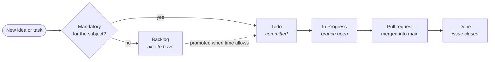
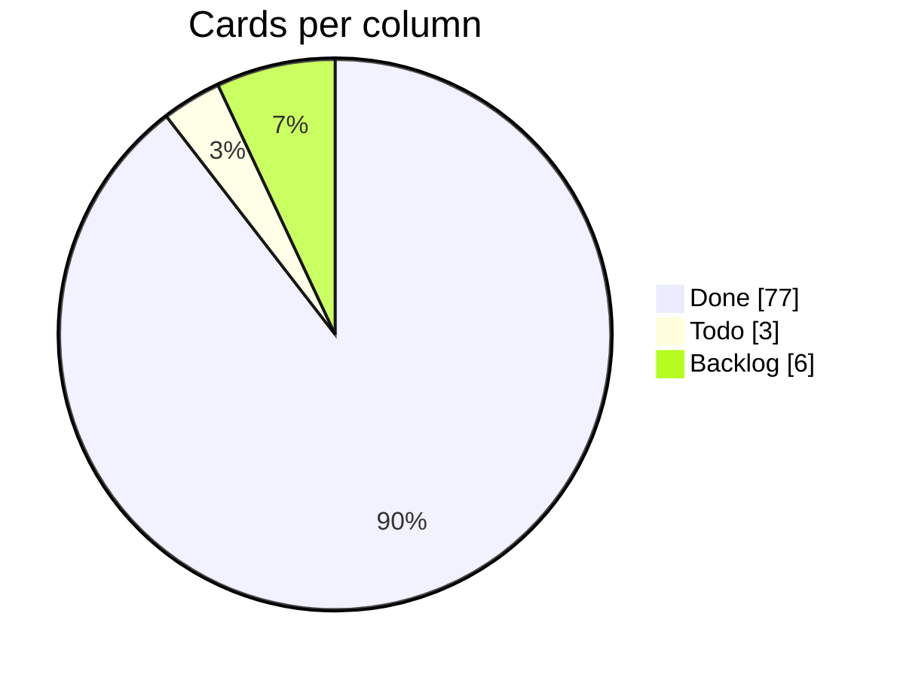
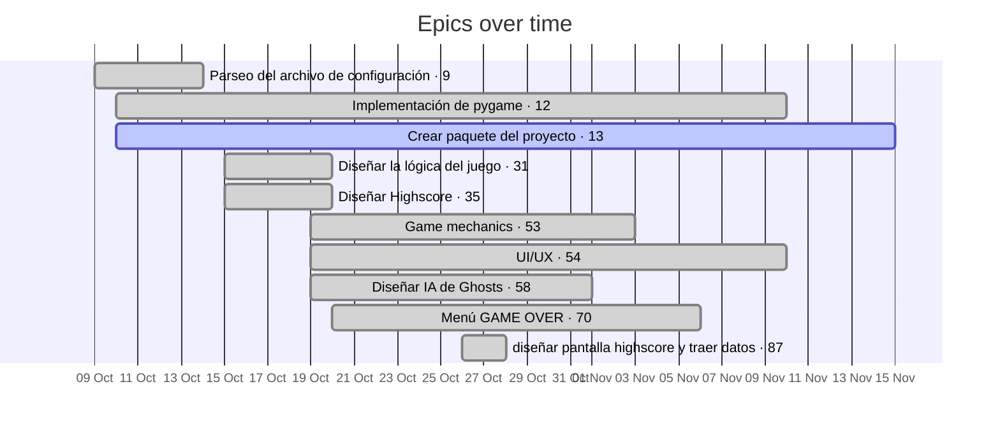
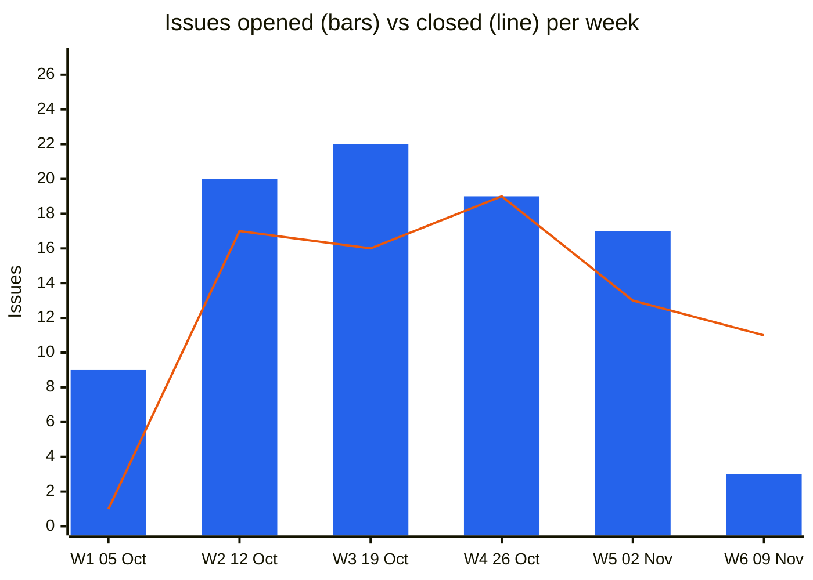
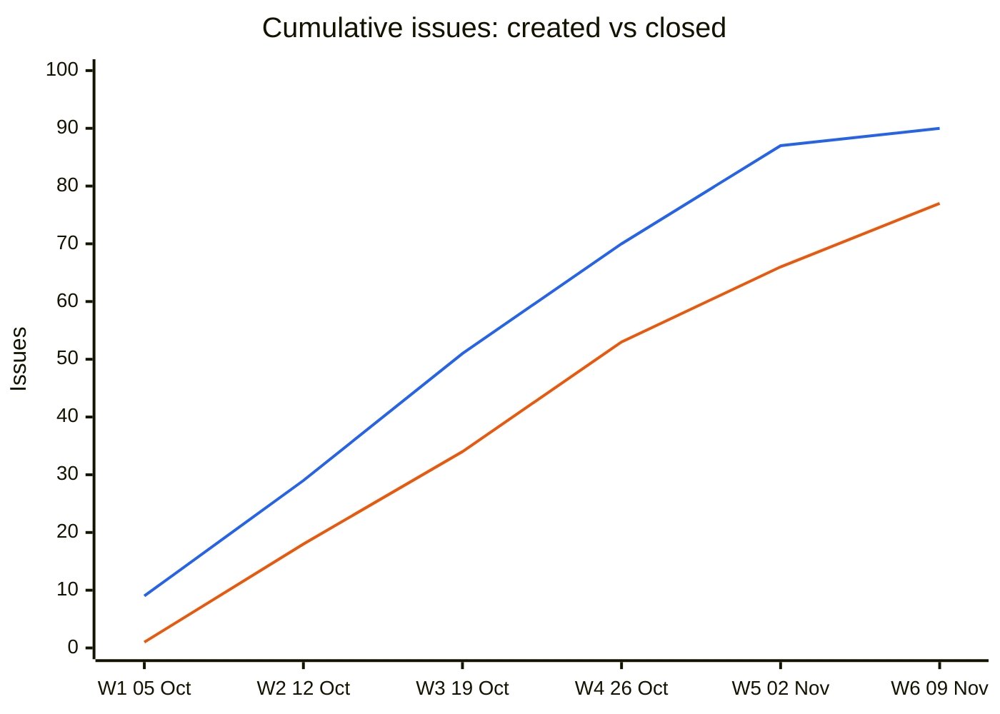
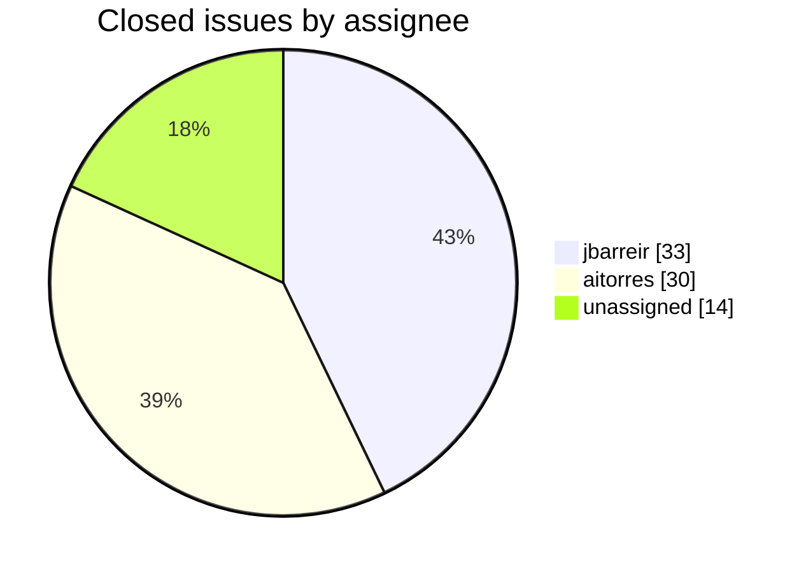
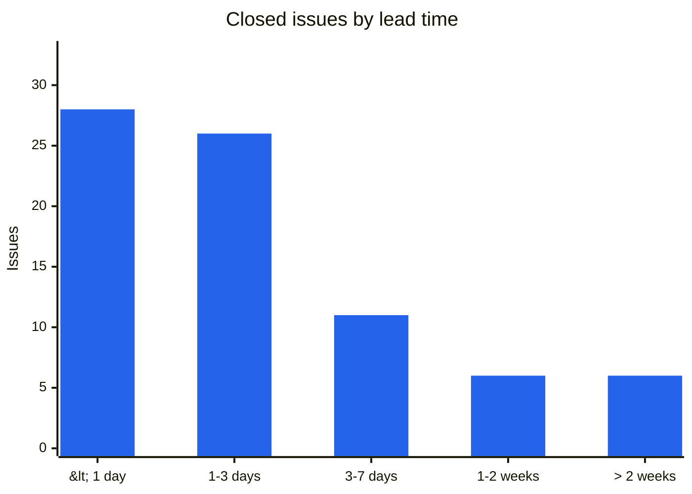

# Project Management

Evidence of how **aitorres** and **jbarreir** planned, tracked and delivered Pac-Man. Every figure on this page is computed from the repository's GitHub issues, pull requests, commit history and the *The Slash Tower* project board, exported on 2026-11-14. The raw exports are in [`data/`](data/).

GitHub accounts map to 42 logins as follows: `barraRRR` is **jbarreir** and `Jaitowerr` is **aitorres**.

## Contents

- [At a glance](#at-a-glance)
- [The Kanban method](#the-kanban-method)
- [Our board](#our-board)
- [Timeline](#timeline)
- [Progress tracking](#progress-tracking)
- [Team organisation](#team-organisation)
- [Lead time](#lead-time)
- [Bugs found and fixed](#bugs-found-and-fixed)
- [Work breakdown](#work-breakdown)
- [Data sources](#data-sources)

---

## At a glance

| Metric | Value |
|---|---|
| Active period | 09 Oct – 13 Nov 2026 (36 days) |
| Issues created | 90 |
| Issues closed | 77 (85 %) |
| Issues still open | 13 |
| Epics (issues with sub-issues) | 10 |
| Pull requests merged | 54 |
| PRs that close an issue | 50 |
| Commits on `main` | 225 |
| Lines added / removed through PRs | +9,570 / −3,934 |
| Median issue lead time | 1.9 days |
| Mean issue lead time | 3.9 days |

## The Kanban method

*Kanban* (看板) is Japanese for "signboard" or "visual card". The method was born on the Toyota production lines in the late 1940s and 1950s, where engineer **Taiichi Ohno** used physical cards to signal when a station needed more parts. Work was *pulled* by real demand instead of being *pushed* by a forecast, which kept inventory low and made bottlenecks visible to everyone on the floor. It became one of the pillars of the Toyota Production System and of lean manufacturing.

In the 2000s **David J. Anderson** adapted the idea to software teams, summarised in his 2010 book *Kanban: Successful Evolutionary Change for Your Technology Business*. The software version keeps the same core principles:

- **Visualise the work**: every task is a card on a shared board.
- **Limit work in progress**: finish things before starting new ones.
- **Manage the flow**: watch how long cards take to cross the board and remove what slows them down.
- **Make policies explicit**: everyone knows what each column means.

Unlike Scrum, Kanban has no fixed sprints or ceremonies. That made it a good fit for a two-person team working around school schedules: the board was the single source of truth, and any of us could see at a glance what the other was doing.

## Our board

The board lives in GitHub Projects as *The Slash Tower* and is linked to this repository. Each card is a GitHub issue, and each issue became a branch named `<issue>-<short-slug>` and a pull request that closed it on merge.



| Column | Policy |
|---|---|
| **Backlog** | Interesting features or improvements that are not required by the subject. They may or may not be done. |
| **Todo** | Committed work, ready to be picked up. |
| **In Progress** | Someone is working on it on its own branch. |
| **Done** | Merged into `main`; the issue is closed. |

### Snapshot on 2026-11-14



| Column | Cards |
|---|---:|
| Backlog | 6 |
| Todo | 3 |
| In Progress | 0 |
| Done | 77 |

**Todo**

- [#13](https://github.com/barraRRR/Pac-Man/issues/13) Crear paquete del proyecto
- [#18](https://github.com/barraRRR/Pac-Man/issues/18) Subir paquete a STEAM
- [#135](https://github.com/barraRRR/Pac-Man/issues/135) Linting

**Backlog**

- [#67](https://github.com/barraRRR/Pac-Man/issues/67) Movimietno de Ghosts continuo
- [#83](https://github.com/barraRRR/Pac-Man/issues/83) Crear una testing suite robusta
- [#91](https://github.com/barraRRR/Pac-Man/issues/91) IDEA dos jugadores, uno letras otro fechas,
- [#145](https://github.com/barraRRR/Pac-Man/issues/145) Ordenar el HIGHSCORE
- [#146](https://github.com/barraRRR/Pac-Man/issues/146) Impedir HIGHSCORE entry si se ha utilizado cheat mode
- [#147](https://github.com/barraRRR/Pac-Man/issues/147) Conseguir la hoja de evaluación

86 of 90 issues are on the board. The ones that are not: [#130](https://github.com/barraRRR/Pac-Man/issues/130) modificar instrucciones, [#111](https://github.com/barraRRR/Pac-Man/issues/111) idea - fantasma tras ser comido, [#96](https://github.com/barraRRR/Pac-Man/issues/96) "Refactorizar instructions.py y pulir la pantalla", [#77](https://github.com/barraRRR/Pac-Man/issues/77) Enter o SPACE?????.

## Timeline

Each bar spans from the creation of an epic or its first sub-issue to the closing of its last sub-issue. Bars marked as active still have open sub-issues.



## Progress tracking

### Weekly throughput



### Burn-up

Total scope (issues created) against work completed (issues closed), cumulative by week. The blue line is issues created and the orange line issues closed; the gap between them is the open work.



| Week | Opened | Closed | Total created | Total closed | Open |
|---|---:|---:|---:|---:|---:|
| W1 05 Oct | 9 | 1 | 9 | 1 | 8 |
| W2 12 Oct | 20 | 17 | 29 | 18 | 11 |
| W3 19 Oct | 22 | 16 | 51 | 34 | 17 |
| W4 26 Oct | 19 | 19 | 70 | 53 | 17 |
| W5 02 Nov | 17 | 13 | 87 | 66 | 21 |
| W6 09 Nov | 3 | 11 | 90 | 77 | 13 |

## Team organisation

`jbarreir` led coordination: repository structure, architecture, issue breakdown and the graphics engine. `aitorres` owned game mechanics, highscore, menus and documentation. The numbers below show how that split played out.



| | jbarreir | aitorres |
|---|---:|---:|
| Issues created | 67 | 23 |
| Issues assigned | 33 | 30 |
| Pull requests merged | 31 | 23 |
| Lines changed through PRs | 6,174 | 7,330 |
| Commits on `main` | 89 | 136 |

27 issues have no assignee; most of them are epics, whose work is tracked in their sub-issues.

Code review was not recorded on GitHub: 53 of 54 pull requests were merged by their own author, and no PR carries a formal review.

## Lead time

Time from opening an issue to closing it.



| Lead time | Issues |
|---|---:|
| < 1 day | 28 |
| 1-3 days | 26 |
| 3-7 days | 11 |
| 1-2 weeks | 6 |
| > 2 weeks | 6 |

Longest-lived issues: [#12](https://github.com/barraRRR/Pac-Man/issues/12) Implementación de pygame (30 days), [#54](https://github.com/barraRRR/Pac-Man/issues/54) UI/UX (21 days), [#56](https://github.com/barraRRR/Pac-Man/issues/56) Crear un logger (21 days), [#71](https://github.com/barraRRR/Pac-Man/issues/71) Diseño de interfaz (20 days), [#31](https://github.com/barraRRR/Pac-Man/issues/31) Diseñar la lógica del juego (18 days). Most of them are epics that stayed open until their last sub-issue was done.

## Bugs found and fixed

| Issue | Title | Opened | Closed | Days | Owner |
|---|---|---|---|---:|---|
| [#52](https://github.com/barraRRR/Pac-Man/issues/52) | [BUG] Error en los spawns de los pacgum | 2026-10-19 | 2026-10-20 | 1.2 | aitorres |
| [#80](https://github.com/barraRRR/Pac-Man/issues/80) | [BUG] Player mantiene movimiento al pasar de nivel | 2026-10-24 | 2026-10-26 | 1.8 | aitorres |
| [#110](https://github.com/barraRRR/Pac-Man/issues/110) | error, super pacgum | 2026-10-30 | 2026-10-31 | 1.2 | aitorres |
| [#117](https://github.com/barraRRR/Pac-Man/issues/117) | [bug] Clyde se queda atascado en su corner cuando huye | 2026-11-01 | 2026-11-01 | 0.1 | jbarreir |

## Work breakdown

Large features were opened as epics and split into sub-issues.

| Epic | Sub-issues | Done | Span |
|---|---|---:|---|
| [#9](https://github.com/barraRRR/Pac-Man/issues/9) Parseo del archivo de configuración | [#17](https://github.com/barraRRR/Pac-Man/issues/17) [#20](https://github.com/barraRRR/Pac-Man/issues/20) [#21](https://github.com/barraRRR/Pac-Man/issues/21) | 3/3 | 09 Oct – 13 Oct |
| [#12](https://github.com/barraRRR/Pac-Man/issues/12) Implementación de pygame | [#25](https://github.com/barraRRR/Pac-Man/issues/25) [#26](https://github.com/barraRRR/Pac-Man/issues/26) [#30](https://github.com/barraRRR/Pac-Man/issues/30) [#39](https://github.com/barraRRR/Pac-Man/issues/39) [#43](https://github.com/barraRRR/Pac-Man/issues/43) [#51](https://github.com/barraRRR/Pac-Man/issues/51) [#54](https://github.com/barraRRR/Pac-Man/issues/54) [#90](https://github.com/barraRRR/Pac-Man/issues/90) [#95](https://github.com/barraRRR/Pac-Man/issues/95) | 9/9 | 10 Oct – 09 Nov |
| [#13](https://github.com/barraRRR/Pac-Man/issues/13) Crear paquete del proyecto | [#15](https://github.com/barraRRR/Pac-Man/issues/15) [#18](https://github.com/barraRRR/Pac-Man/issues/18) | 1/2 | 10 Oct – ongoing |
| [#31](https://github.com/barraRRR/Pac-Man/issues/31) Diseñar la lógica del juego | [#32](https://github.com/barraRRR/Pac-Man/issues/32) [#33](https://github.com/barraRRR/Pac-Man/issues/33) [#34](https://github.com/barraRRR/Pac-Man/issues/34) [#35](https://github.com/barraRRR/Pac-Man/issues/35) | 4/4 | 15 Oct – 19 Oct |
| [#35](https://github.com/barraRRR/Pac-Man/issues/35) Diseñar Highscore | [#45](https://github.com/barraRRR/Pac-Man/issues/45) [#46](https://github.com/barraRRR/Pac-Man/issues/46) [#47](https://github.com/barraRRR/Pac-Man/issues/47) | 3/3 | 15 Oct – 19 Oct |
| [#53](https://github.com/barraRRR/Pac-Man/issues/53) Game mechanics | [#55](https://github.com/barraRRR/Pac-Man/issues/55) [#58](https://github.com/barraRRR/Pac-Man/issues/58) [#78](https://github.com/barraRRR/Pac-Man/issues/78) [#89](https://github.com/barraRRR/Pac-Man/issues/89) [#103](https://github.com/barraRRR/Pac-Man/issues/103) | 5/5 | 19 Oct – 02 Nov |
| [#54](https://github.com/barraRRR/Pac-Man/issues/54) UI/UX | [#68](https://github.com/barraRRR/Pac-Man/issues/68) [#69](https://github.com/barraRRR/Pac-Man/issues/69) [#70](https://github.com/barraRRR/Pac-Man/issues/70) [#71](https://github.com/barraRRR/Pac-Man/issues/71) [#81](https://github.com/barraRRR/Pac-Man/issues/81) | 5/5 | 19 Oct – 09 Nov |
| [#58](https://github.com/barraRRR/Pac-Man/issues/58) Diseñar IA de Ghosts | [#61](https://github.com/barraRRR/Pac-Man/issues/61) [#63](https://github.com/barraRRR/Pac-Man/issues/63) [#64](https://github.com/barraRRR/Pac-Man/issues/64) [#65](https://github.com/barraRRR/Pac-Man/issues/65) [#102](https://github.com/barraRRR/Pac-Man/issues/102) | 5/5 | 19 Oct – 31 Oct |
| [#70](https://github.com/barraRRR/Pac-Man/issues/70) Menú GAME OVER | [#121](https://github.com/barraRRR/Pac-Man/issues/121) [#122](https://github.com/barraRRR/Pac-Man/issues/122) [#123](https://github.com/barraRRR/Pac-Man/issues/123) | 3/3 | 20 Oct – 05 Nov |
| [#87](https://github.com/barraRRR/Pac-Man/issues/87) diseñar pantalla highscore y traer datos | [#97](https://github.com/barraRRR/Pac-Man/issues/97) | 1/1 | 26 Oct – 27 Oct |

## Data sources

The exports in [`data/`](data/) were produced with the GitHub CLI:

```bash
gh issue list --state all --json number,title,state,createdAt,closedAt,author,assignees
gh pr list --state all --json number,title,createdAt,mergedAt,author,mergedBy,additions,deletions,closingIssuesReferences
gh project item-list 3 --owner barraRRR --format json
git log origin/main --format='%ae'
```

GitHub Projects does not expose the history of column changes, so the board appears here as a snapshot; the flow over time is reconstructed from issue creation and closing dates.
